# AWS Lambda, DynamoDB, EventBridge Scheduler and Scheduled S3 Backups

This repository contains my AWS serverless assignment implementation using **AWS Lambda, Amazon DynamoDB, Amazon S3, Amazon EventBridge Scheduler, IAM, and Amazon CloudWatch**.

The main goal of this assignment was to import user data from a public API into DynamoDB and create scheduled JSON backups of the DynamoDB data in Amazon S3.

## Architecture

```text
JSONPlaceholder Public API
          |
          v
Lambda #1: import-jsonplaceholder-users
          |
          v
Amazon DynamoDB
jsonplaceholder-users
          |
          v
Lambda #2: export-dynamodb-to-s3
          |
          v
Amazon S3
Scheduled JSON Backups

Amazon EventBridge Scheduler
          |
          | Every 2 minutes
          v
Lambda #2
```

## AWS Region

All AWS resources for this assignment were created in:

```text
ap-south-1 (Asia Pacific - Mumbai)
```

## AWS Services Used

- AWS Lambda
- Amazon DynamoDB
- Amazon S3
- Amazon EventBridge Scheduler
- AWS Identity and Access Management (IAM)
- Amazon CloudWatch

## Implementation

### 1. DynamoDB Table

A DynamoDB table named:

```text
jsonplaceholder-users
```

was created with:

```text
Partition key: id
Type: Number
```

No sort key was used.

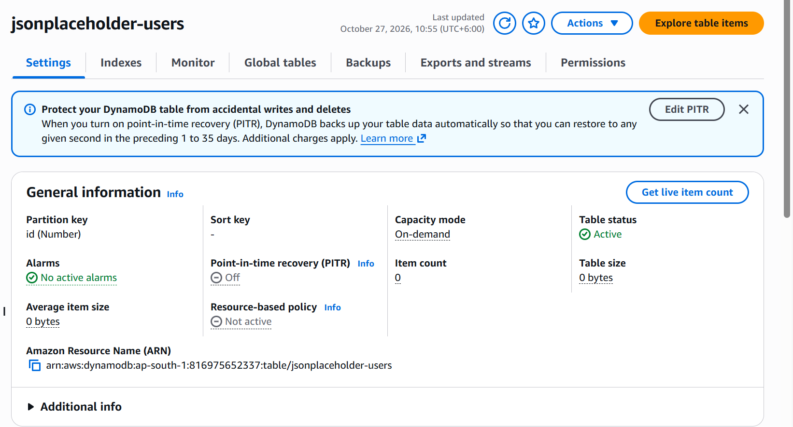

---

### 2. Import Users with Lambda

The first Lambda function was created as:

```text
import-jsonplaceholder-users
```

This function fetches user data from:

```text
https://jsonplaceholder.typicode.com/users
```

and writes the users into the DynamoDB table.

The environment variable used by the function was:

```text
TABLE_NAME=jsonplaceholder-users
```

The function was given permission to perform:

```text
dynamodb:PutItem
```

on the DynamoDB table.

After running the Lambda function, 10 user records were successfully stored in DynamoDB.

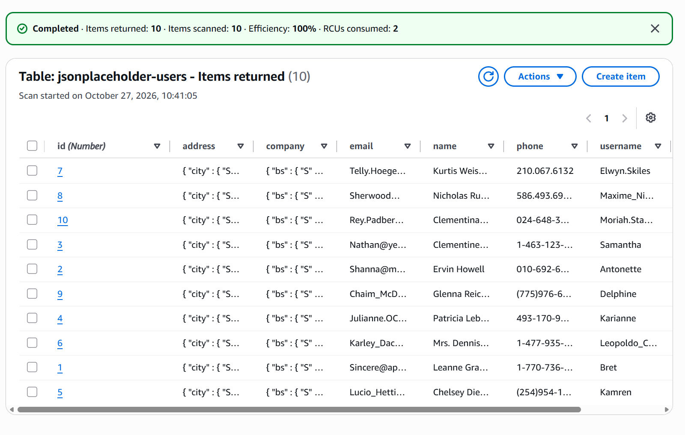

The Lambda function also completed successfully with:

```text
saved_count: 10
```

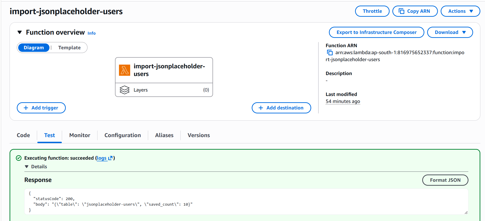

---

### 3. Export DynamoDB Data to S3

The second Lambda function was created as:

```text
export-dynamodb-to-s3
```

This function scans the DynamoDB table, converts the records into JSON format, and stores the backup in Amazon S3.

The following environment variables were used:

```text
TABLE_NAME=jsonplaceholder-users
BUCKET_NAME=<S3_BUCKET_NAME>
BACKUP_PREFIX=backups
```

The Lambda execution role was given permission to perform:

```text
dynamodb:Scan
s3:PutObject
```

The Lambda function was manually tested successfully and exported all 10 records.

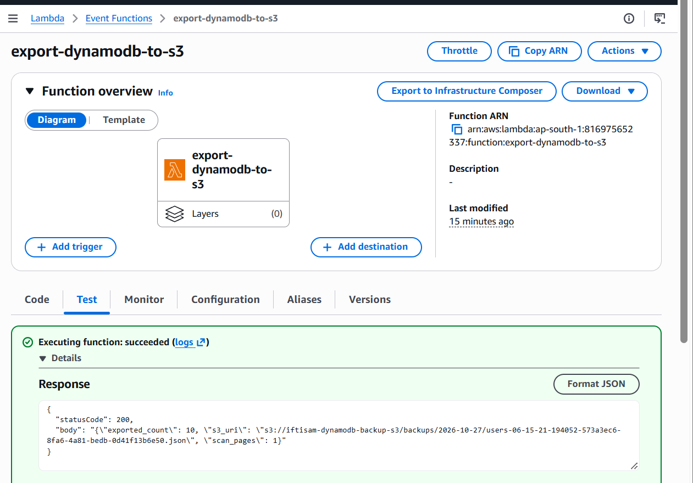

A timestamped JSON backup file was successfully created in S3.

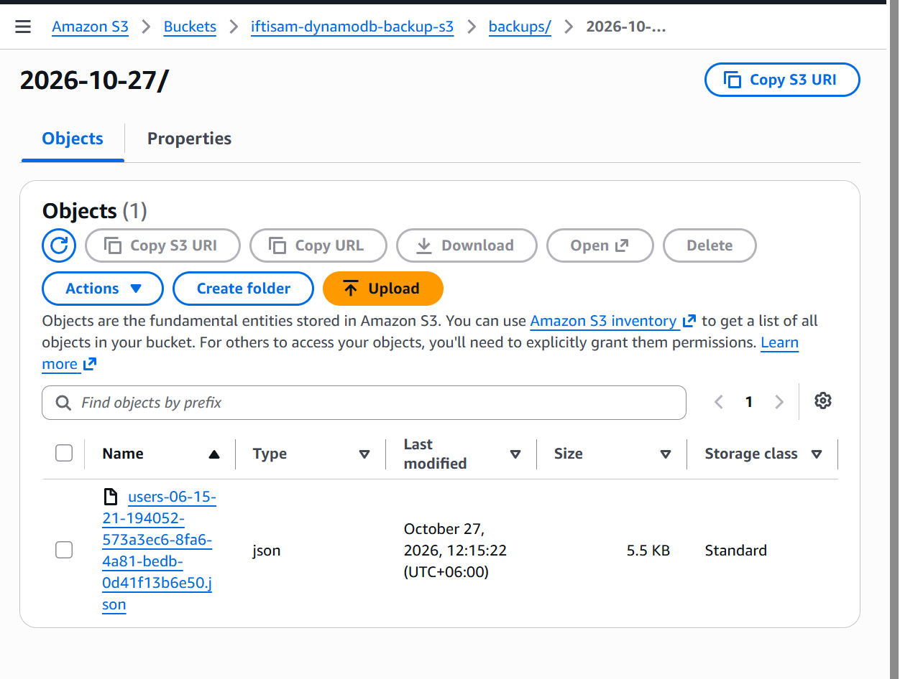

The function was manually executed more than once to confirm that every execution creates a new backup file instead of overwriting the previous backup.

---

### 4. Scheduled Backup with EventBridge Scheduler

An Amazon EventBridge Scheduler schedule was created with the following name:

```text
dynamodb-backup-every-2min
```

The schedule expression was:

```text
rate(2 minutes)
```

The target was:

```text
export-dynamodb-to-s3
```

A separate Scheduler execution role was created to allow EventBridge Scheduler to invoke the Lambda function.

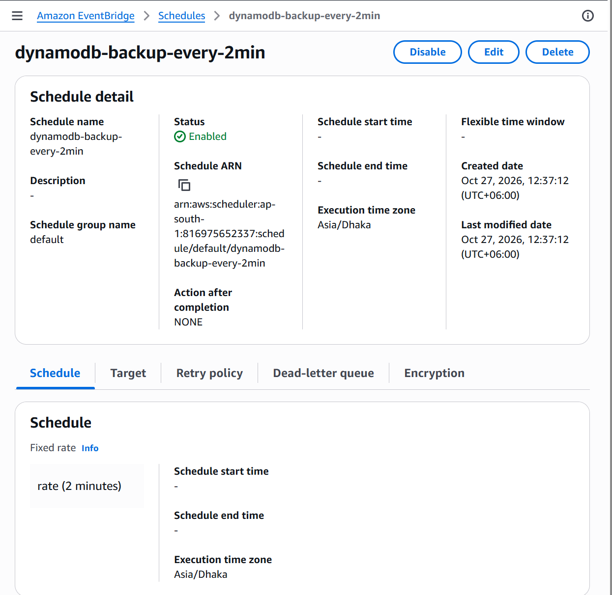

After enabling the schedule, Lambda #2 was automatically invoked every 2 minutes and new JSON backup files were created in S3.

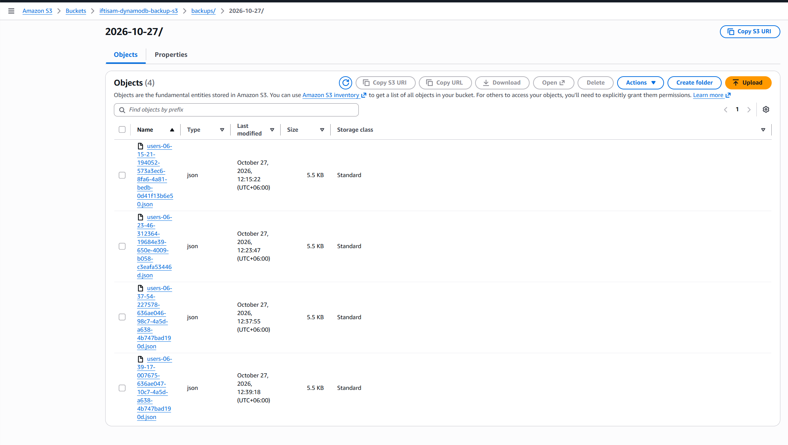

---

## IAM Permissions

Least-privilege IAM permissions were used for this assignment.

### Lambda #1

The first Lambda function only required permission to write items to the DynamoDB table:

```text
dynamodb:PutItem
```

### Lambda #2

The second Lambda function required permission to:

```text
dynamodb:Scan
s3:PutObject
```

### EventBridge Scheduler

The Scheduler execution role was used only to invoke the backup Lambda function.

This keeps the responsibilities of the Lambda execution roles and the Scheduler execution role separate.

---

## Monitoring with CloudWatch

Amazon CloudWatch was used to monitor the Lambda functions.

### Lambda #1 Logs

The CloudWatch logs confirmed that the users were successfully written to DynamoDB.

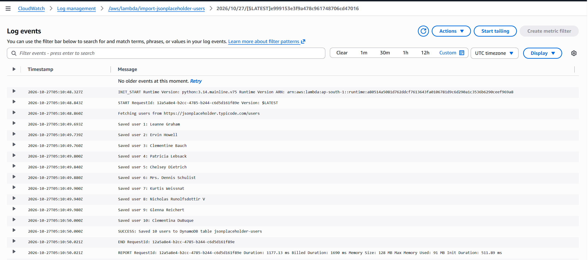

### Lambda #2 Logs

The backup Lambda logs showed the DynamoDB export process and the S3 backup location.

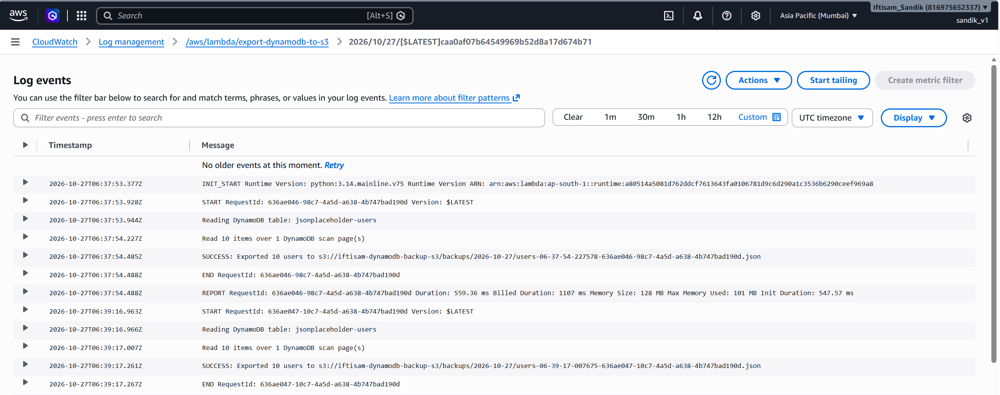

### Lambda Metrics

Lambda metrics such as **Invocations**, **Duration**, and **Errors** were also checked.

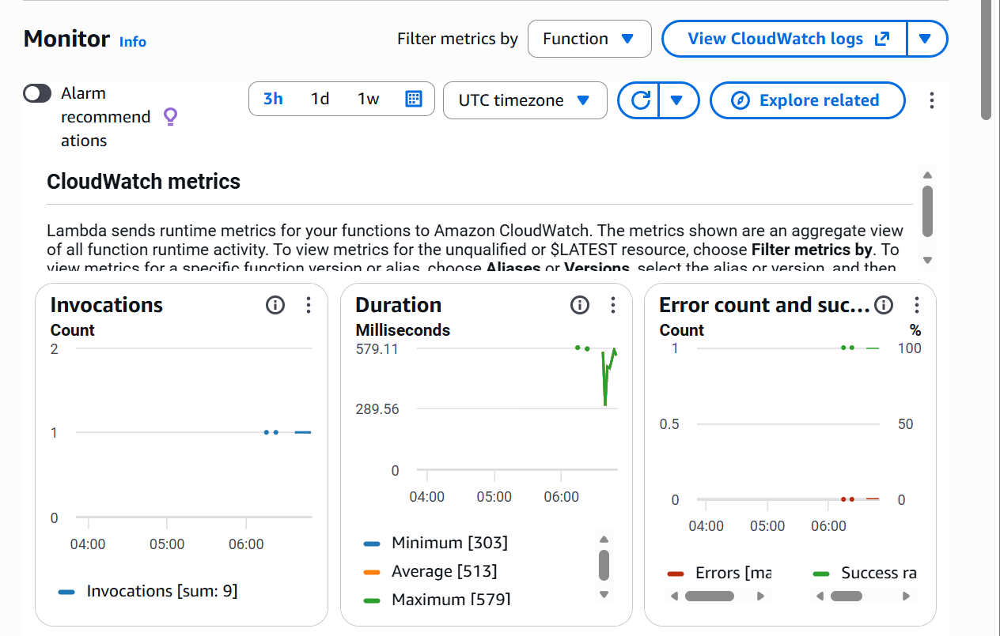

---

## Backup Verification

The S3 JSON backup file was opened and verified.

The exported records contained user information such as:

- Name
- Email
- Address
- Company

Each Lambda #2 execution created a new timestamped JSON object instead of modifying the previous backup file.

---

## Cleanup

After completing and verifying the scheduled backups, the EventBridge Scheduler was disabled to stop unnecessary Lambda executions and S3 backup creation.

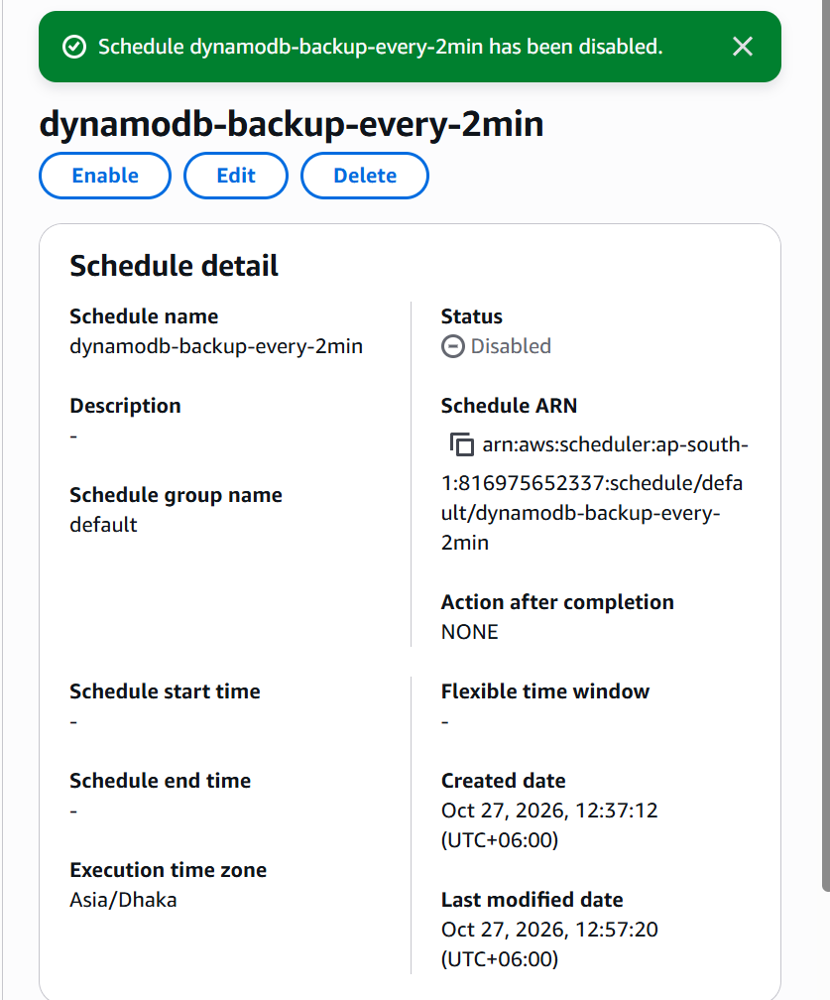

---

## Assignment Questions and Answers

The required assignment questions and answers are available here:

[Assignment Questions and Answers](Assignment-Questions-and-Answers.md)

---

## Original Assignment Instructions

The original assignment requirements have been preserved in:

[Assignment Instructions](Assignment-Instructions.md)

---

## Repository Structure

```text
AWS-Lambda-DynamoDB-Scheduled-S3-Backups/
│
├── ScreenShots/
│   ├── 01-dynamodb-table-id-number.png
│   ├── 02-dynamodb-10-users-written.png
│   ├── 03-lambda1-test-success.png
│   ├── 04-lambda2-manual-test-success.png
│   ├── 05-s3-manual-backup-file.png
│   ├── 06-eventbridge-scheduler-enabled.png
│   ├── 07-s3-scheduled-backups.png
│   ├── 08-lambda1-cloudwatch-logs.png
│   ├── 09-lambda2-cloudwatch-logs.png
│   ├── 10-lambda2-cloudwatch-metrics.png
│   └── 11-scheduler-disabled.png
│
├── iam_policies/
├── lambda_src/
├── lambda_zips/
├── Assignment-Instructions.md
├── Assignment-Questions-and-Answers.md
└── README.md
```

## Result

The complete workflow was successfully implemented:

```text
Public API
    ↓
Lambda #1
    ↓
DynamoDB
    ↓
Lambda #2
    ↓
S3 Backup

EventBridge Scheduler
    ↓
Lambda #2 every 2 minutes
    ↓
New S3 JSON Backup
```

The assignment demonstrates a basic serverless workflow for importing data, exporting DynamoDB records to S3, scheduling automatic backups, applying IAM permissions, and monitoring the solution with CloudWatch.